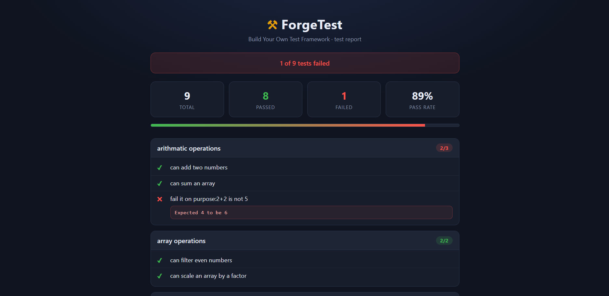

# ForgeTest

A tiny Jest-style test framework built from scratch in JavaScript, with a terminal runner and a browser test report.

## Live Demo
https://forgetest-hb.netlify.app

## Screenshot


## Built With
- JavaScript (ES modules)
- HTML5
- CSS3 (custom properties, Grid, Flexbox)
- Node.js (for the terminal runner)

## Features
- `describe` and `it` for grouping and registering tests
- `expect` matchers: `toBe`, `toEqual`, `toBeCloseTo`, `toBeTruthy`, `toBeFalsy`, `toBeGreaterThan`, `toBeLessThan`, `toContain` and `toThrow`
- Recursive deep equality for comparing arrays and objects
- Each test runs in its own `try/catch`, so one failure never stops the rest
- Two front ends sharing one framework: a colored terminal report and a browser report with pass/fail counts, pass rate and a progress bar
- HTML escaping for test names before they are rendered in the page

## Getting Started

### Prerequisites
- A web browser for the report page
- Node.js (optional, only for the terminal runner)

### Installation
```bash
git clone https://github.com/harshilbhojwani/forgetest.git
cd forgetest
```

Run in the terminal:
```bash
node run.js
```

Run in the browser: serve the folder with a local server (for example the VS Code Live Server extension) and open `index.html`. Opening the file directly will not work, because browsers block ES module imports from `file://` addresses.

## What I Learned
Built as Sprint 4 of the GeeksforGeeks MERN course. I learned how test frameworks work internally: how `describe` and `it` register tests, how `expect` returns matcher functions, and how closures and module-level state hold everything together.

## Notes
Built as part of Sprint 4 (Build Your Own Test Framework) of the GeeksforGeeks MERN Full Stack course.

One test in `specs.js` fails on purpose. It exists to show the failure reporting working, so the report shows `1 of 9 tests failed` by design.